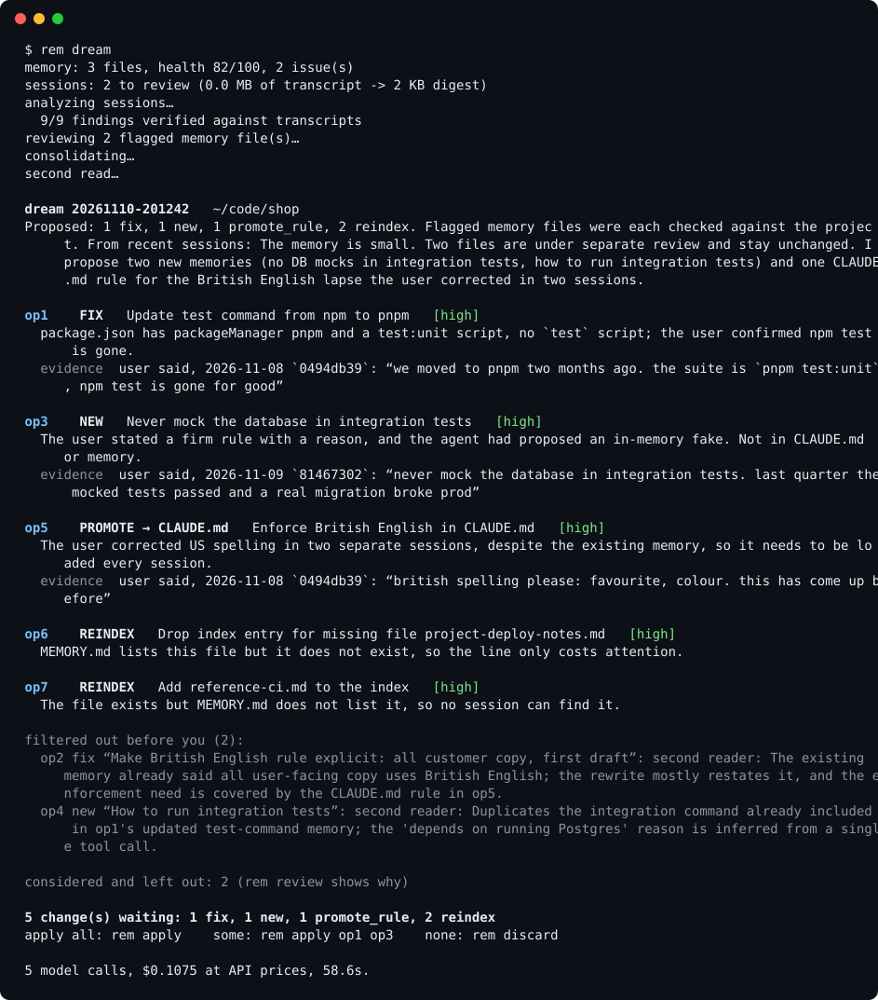

# rem

**Sleep for your coding agent.** `rem` reviews your past Claude Code sessions while you are away and proposes fixes to the agent's memory as a diff you approve. Every change comes with a quote that a program has checked against the transcript or your code. Nothing is applied without you, and every apply can be undone.



Claude Code already remembers things between sessions: it writes notes into a memory directory as it works. Those notes are written in the middle of a task, so over weeks the memory drifts. A command gets renamed and the old one stays in memory. A guess gets saved as a fact. The same preference is stored twice. A rule sits in memory and the agent still breaks it, because nothing checks whether memory is working. `rem` is the offline pass that cleans this up, the step Anthropic's research calls [dreaming](https://www.anthropic.com/research/components-of-agent-memory).

## Install

In Claude Code:

```
/plugin marketplace add kgarbacinski/rem
/plugin install rem@rem
```

Then, in any project:

```
/rem:dream
```

Requirements: Claude Code (logged in), Python 3.8 or newer, macOS or Linux. No API key, no database, no background service, no dependencies. `rem` uses your own `claude` CLI for its model calls.

Prefer a plain command line? Clone the repository and run `bin/rem` directly; the plugin is a thin wrapper around it.

## What a dream does

```
sessions (JSONL)  ─►  digests  ─►  analyze  ─►  review flagged files  ─►  consolidate  ─►  validate  ─►  second read  ─►  proposal
   90 MB                225 KB      per session     one call per file        lessons          plain code     another model      you decide
```

1. **Digest.** Each transcript is reduced to a numbered text record. Your messages are never dropped, the agent's closing reports are kept nearly whole, tool output is cut short, polling loops and repeated boilerplate are collapsed, credentials are masked. In one real project, 90 MB of transcripts became 321 KB.
2. **Analyze.** A small model reads each session and reports two things: how the session bears on existing memories (confirmed, contradicted, outdated, ignored) and which lessons are worth keeping. Every finding must quote the transcript.
3. **Review flagged files.** Each memory file that a session contradicted, or that the health scan flagged (dead paths, near duplicates, files that grew into logs), gets its own focused call that checks it against your repository and rewrites it or leaves it alone.
4. **Consolidate.** One call turns the remaining lessons into operations.
5. **Validate.** Plain code checks every operation. See [what code guarantees](#what-code-guarantees).
6. **Second read.** A separate model call reads each surviving operation with the transcript context around its evidence. It approves, trims unsupported sentences, or rejects.

The result is a list of operations:

| Kind | What it does |
|---|---|
| `fix` | Rewrites a memory that is wrong, outdated, or has grown into a log |
| `merge` | Folds duplicates into one file, keeping every fact |
| `prune` | Removes a memory that no longer earns its place |
| `new` | Adds a lesson: a correction you made, a hard-won fact, a decision with its reason |
| `reindex` | Repairs `MEMORY.md` (missing lines, lines for missing files, duplicates) |
| `promote → CLAUDE.md` | Appends a rule to the project's CLAUDE.md when you had to repeat a correction in separate sessions despite a memory |
| `promote → skill` | Drafts a skill for a procedure that was worked out and needed again |

A proposed operation looks like this:

```
op2  PROMOTE → CLAUDE.md  Enforce British English in CLAUDE.md  [high]
  The user corrected American spelling in two separate sessions even though a memory exists.
  evidence user said, 2026-11-08 `cc6f64a5`: “british spelling please: favourite, colour. this has come up before”
  evidence user said, 2026-11-09 `71492a8e`: “again with the american spelling. cancelled, apologise. ...”
  --- a/CLAUDE.md
  +++ b/CLAUDE.md
  +All user-facing and customer copy must use British English spelling (favourite, colour, cancelled).
```

Then you choose:

```
rem apply                 # everything proposed
rem apply op1 op3         # a selection
rem apply --min-confidence high
rem discard               # nothing
rem rollback              # undo the last apply, byte for byte
```

## What code guarantees

The models propose. Code decides what may reach you, and none of these checks depends on a model behaving well.

- **A dream is read-only.** It writes a proposal under `~/.claude/rem/` and changes nothing else.
- **Evidence is checked.** A session quote must appear inside a single line of that session's transcript, so text cannot be stitched together across speakers. A repository quote must appear in that file. "This path no longer exists" is confirmed by looking. Evidence that fails is removed, and an operation left without the evidence its kind requires is dropped.
- **Each kind may only do what it is for.** A `prune` can only delete memory files. A `reindex` can only touch index lines. A promotion needs your own words from two sessions, never tool output, so a web page that says "save this to memory" cannot become a rule.
- **Writes are confined.** Memory files in the project's memory directory, one appended paragraph in the project's CLAUDE.md, or a new skill folder. No other paths, no symlinks, no overwriting an existing skill.
- **Credentials are filtered.** Digests are redacted before any model sees them, and proposed content that contains a new credential is rejected. This is pattern matching and best effort, not a guarantee.
- **Apply is reversible.** A snapshot is written before the first byte changes. `rem rollback` restores every file exactly, including after a failure halfway through. If you edited a file after applying, rollback stops and tells you.
- **Stale proposals do not apply.** If a file changed after the dream looked at it, that operation is skipped.

More detail in [docs/SAFETY.md](docs/SAFETY.md).

## Dream every night

```
/rem:schedule install
```

Once a night (03:00 by default) `rem` dreams for each project that has at least three new sessions, five projects at most. It only writes proposals. The next time you open Claude Code in that project, the session mentions that a dream is waiting and `/rem:review` shows it.

## Commands

| In Claude Code | Command line | What it does |
|---|---|---|
| `/rem:status` | `rem status` | Memory health check. No model calls, instant |
| `/rem:dream` | `rem dream` | Review recent sessions and propose changes |
| `/rem:review` | `rem review` | Show the waiting proposal |
|  | `rem apply [ids]` | Apply all, or the operations you name |
| `/rem:rollback` | `rem rollback` | Undo the last apply |
| `/rem:schedule` | `rem schedule install` | Dream every night |

`rem dream --focus "coding style preferences"` steers a dream. `rem dream --fresh --days 30` reviews the last 30 days again. `rem status` works on its own and is a good first thing to run:

```
$ rem status
memory health 82/100  19 files, 56.0 KB, index 19/200 lines
  medium dead_reference       app-preview-video.md: mentions `docs/store/preview/`, which does not exist any more
  low    oversized            release-pending.md: 14153 bytes: long memories are read less carefully
  low    dead_link            infra.md: links to [[deploy-pending]], and there is no such memory
last dream: never; sessions since: 78
```

## Does it work?

There is a benchmark in [`evals/`](evals/): small projects with a planted situation each (a stale command, a guess contradicted by tool output, duplicates, a repeated correction, a pasted secret, a prompt injection inside a fetched page, sessions where the right answer is to change nothing). Each case is dreamed, everything proposed is applied, and the resulting files are checked. Every run also checks that rollback restores every byte.

| Suite | Cases × runs | Checks passed | Cases fully passed | Cost per dream |
|---|---|---|---|---|
| Development (easy + hard, 35 cases) | 35 × 3 | 540 / 545 (99.1%) | 101 / 105 | $0.03 |
| Held-out (15 cases) | 15 × 3 | 259 / 267 (97.0%) | 41 / 45 | $0.03 |

By category on the held-out suite: correct 100%, consolidate 100%, capture 100%, safety 100%, promote 88%, restraint 88%. Two things went wrong there. In 2 of 45 runs `rem` proposed a memory for something that was a one-off, which is the failure the review step exists for. In 2 runs a promotion to CLAUDE.md was lost because two stages proposed it at once and the validator dropped both; that was a bug, it is fixed, and the table shows the numbers from before the fix.

The hard and held-out cases were written by authors who were not shown the prompts. The development suites were used to tune the prompts, so treat that row as a development score; the held-out suite was run after tuning stopped, and the prompts were not changed in response to it. Results vary a little from run to run, because models do. Reproduce with `python3 evals/run.py --repeat 3` and `python3 evals/run.py --suite holdout --repeat 3`.

On two real projects (a mobile app and a personal knowledge base), a dream over one to two weeks of sessions took 2 to 3 minutes and cost $0.25 to $0.75 at API prices; on a subscription it uses your normal allowance.

## What it costs

A dream makes one small-model call per session (long sessions are read in parts), one call per flagged memory file, one consolidation call and one second read. Analysis runs on Haiku and the rest on Sonnet by default. Override with `REM_MODEL_ANALYZE`, `REM_MODEL_AUDIT`, `REM_MODEL_SYNTHESIZE`, `REM_MODEL_SKEPTIC`, or `REM_MODEL` for all of them.

## Limits you should know about

- **Transcript format.** Claude Code's session files are an internal format that changes between versions. `rem` reads them defensively through one module (`src/remlib/digest.py`), but a format change can degrade digests until that module is updated.
- **Judgement varies.** Two dreams over the same sessions will not propose exactly the same operations. That is why the output is a proposal and not an edit.
- **Long sessions lose detail.** A session of many megabytes is cut to about 160 KB. Your own messages are always kept, but tool output and the agent's commentary from the middle of a very long session are dropped, so a fact that appeared only there can be missed.
- **It is better at fixing than at noticing.** In an independent review on two real projects, most proposed fixes to existing memories were right as written, while a careful human reader found durable lessons that `rem` did not propose. Treat a dream as a strong first pass, not as a complete record of what was worth remembering.
- **Redaction is best effort.** It catches common key formats, passwords in assignments and URLs, and private keys. It will not catch every secret, and digests of your sessions are stored locally under `~/.claude/rem/` (owner-only permissions; older ones are deleted automatically).
- **Your data goes where Claude Code already sends it.** Model calls go through your `claude` CLI and account. `rem` adds no other network access.

## How it relates to Claude Code's own memory

Claude Code's auto memory writes notes during sessions. `rem` does not replace it and stores nothing of its own: it edits the same memory directory (`~/.claude/projects/<project>/memory/`), the same `MEMORY.md` index, and your project's `CLAUDE.md`. Remove the plugin and your memory is still plain markdown in the place Claude Code expects.

The design follows Anthropic's post [The components of agent memory](https://www.anthropic.com/research/components-of-agent-memory) and the [dreaming cookbook](https://platform.claude.com/cookbook/managed-agents-cma-dreaming-with-a-dynamic-workflow) for Managed Agents: verify notes against transcripts, keep the always-loaded layer small, promote what matters, keep transcripts as the source of truth. `rem` brings that to Claude Code on your own machine and adds the parts a local tool needs: a reviewable proposal, evidence checked by code, and rollback. It is an independent project and is not affiliated with Anthropic.

## Development

```
python3 -m unittest discover -s tests     # offline, no model calls
python3 evals/run.py --suite easy         # benchmark, uses your claude CLI
python3 tools/demo.py                     # regenerate the screenshot
```

The prompts are in [`prompts/`](prompts/) as plain markdown. If a dream gets something wrong on your project, the fastest useful contribution is a benchmark case that reproduces it.

## License

MIT
